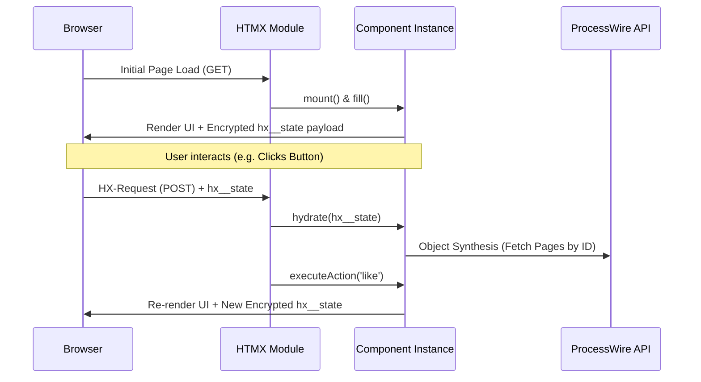

# ProcessWire HTMX Module


A powerful HTMX integration module designed specifically for ProcessWire. It bridges the gap between client-side reactivity and server-side authority, enabling you to build SPA-like interactions without abandoning traditional PHP rendering.

By unifying **State-Aware Components**, **HMAC-SHA256 Payload Security**, and ProcessWire's native architecture, this module provides the ultimate Developer Experience (DX) inspired by frameworks like Livewire—exclusively for ProcessWire.

---

## 🏗 Executive Overview

- **Natively Bundled:** Supplies HTMX 4.x, official extensions like `hx-ws` and `hx-sse`, along with `_hyperscript`, completely zero-dependency.
- **State-Aware Component Architecture:** Seamless data hydration and dehydration between requests.
- **Object Synthesis:** Magically serialize full ProcessWire objects (like `Page`) down to lightweight secure IDs, restoring them effortlessly on the next request.
- **Cryptographic Security:** End-to-end state manipulation protection with built-in HMAC-SHA256 signatures and TTL-based Replay Protection.
- **Fluent Request/Response API:** Intercept, retarget, flash messages, and trigger custom JS events directly from ProcessWire controllers.

---

## ⚙️ Installation

**Via Composer (Recommended):**

```bash
composer require trk/processwire-htmx
```

**Via Manual Download:**

1. Clone or extract into `site/modules/Htmx/`.
2. In the ProcessWire Admin, log in and navigate to **Modules > Refresh**.
3. Install **HTMX**.

---

## 🧠 Core Architecture: Component Lifecycle

The true power of this module lies in the `Component` class. It shifts PHP from a "fire-and-forget" mentality to a persistent, stateful application logic container.



---

## 🧩 Advanced: State Payload Keys & Multiple Instances

By default, state is transported via a signed payload named **`hx__state`** (rendered by `Component::renderStatePayload()`).

If you embed **multiple HTMX components inside the same ProcessWire form**, it is possible to end up with multiple `hx__state` inputs in the POST. In certain contexts, ProcessWire may also represent this value as an array.

This module supports **instance-specific state keys** to avoid collisions:

- Use `Component::setStateKey('hx__state__{targetId}')` during render.
- Ensure your HTMX request uses a matching `hx-target` (so the server can resolve the correct payload).
- The endpoint will prefer `hx__state__{HX-Target}` when present, and fall back to `hx__state`.

### Best Practice Snippet (Multiple Components in One Form)

```php
// Example: render two independent components inside the same ProcessWire form.
// Key idea: make hx-target unique and set an instance-specific state key that matches it.
// HTMX 4 syntax: hx-action + hx-method + outerMorph swap.

$targetId = 'blocks-editor-body';

/** @var \Htmx\Component\SomeComponent $cmp */
$cmp = new \Htmx\Component\SomeComponent();
$cmp->setStateKey('hx__state__' . $targetId);

echo "<div id='{$targetId}'>";
echo "<form hx-action='{$cmp->requestUrl()}' hx-method='post' hx-target='#{$targetId}' hx-swap='outerMorph'>";
echo $cmp->renderStatePayload();
echo $cmp; // or $htmx->renderComponent(...)
echo "</form>";
echo "</div>";
```

## 🌐 Subdirectory Installs & Endpoint URLs

For ProcessWire installs living in a subdirectory (where `config()->urls->root` is not `/`), `Component::requestUrl()` will automatically prefix the endpoint with the install root for client-side URL correctness (unless you provide an absolute URL).

## 🛡 Admin Safety: Full-Document Swap Guard

In the ProcessWire admin, the module loads `resources/htmx/pw-htmx-guard.js` to prevent accidental swaps where an HTMX request returns a full HTML document (common causes: wrong endpoint, login redirect, CSRF issues).

- If a full document is detected, the swap is cancelled.
- You can override the alert message by defining `window.__pwHtmxGuardMessage` before the swap occurs.

## 🐞 Debugging with TracyDebugger (Debug Mode Only)

When **ProcessWire debug mode** is enabled and the **TracyDebugger** module is installed, Htmx can provide extra debugging support (enabled by default via the module config option `tracySupport`):

- Adds a **Tracy bar panel** named **HTMX** with request/endpoint details.
- Emits **debug response headers** on HTMX requests (useful in the browser Network tab):
  - `X-PW-HTMX`
  - `X-PW-HTMX-ReqId`
  - `X-PW-HTMX-Component`
  - `X-PW-HTMX-Action`
  - `X-PW-HTMX-Target`
  - `X-PW-HTMX-StateKey`
  - `X-PW-HTMX-OOB`
  - `X-PW-HTMX-Error-Code` (stable error identifiers)
  - `X-PW-HTMX-Exception` (exception class, no message redaction)

### Error Codes (`X-PW-HTMX-Error-Code`)

These values are designed to be stable and safe to expose in headers (no sensitive payload data):

- `not_post` — endpoint called with a non-POST request
- `missing_state` — missing `hx__state` (or `hx__state__{target}`) payload in POST
- `malformed_state` — state payload did not match the expected `{base64}|{hmac}` format
- `bad_hmac` — HMAC signature did not match (tampering or wrong salt)
- `invalid_state` — decoded state structure missing `__cmp` or invalid payload structure
- `invalid_component` — resolved component class missing or not a valid `Totoglu\Htmx\Component`
- `exception` — unhandled exception during hydrate/action/render

### Client Debug Toggle (Admin / Debug Only)

In admin pages, when `config->debug` is enabled, the module loads `pw-htmx-debug.js`. It is a no-op unless you explicitly enable it:

```js
window.__pwHtmxDebug = true;
```

This integration is **never active in production** unless `config->debug` is enabled.

## 🪄 Zero-Configuration Auto-Discovery

To make the developer experience as seamless as possible, the HTMX module includes automatic namespace registration for your components and UI elements.

### Site-Level Discovery

By default, if the following directories exist in your ProcessWire installation, they are automatically registered with the native `ClassLoader`:

- **`site/components/`** maps to the **`Htmx\Component`** namespace.
- **`site/ui/`** maps to the **`Htmx\Ui`** namespace.

_Note: These directory paths are fully customizable (e.g. `my-components/`) via the Module Configuration screen._

This means you can place your component class files directly in `site/components/` and simply declare the `namespace Htmx\Component;`, and the module will instantly know how to load and render them during stateless POST requests without requiring custom auto-loaders or `require_once` statements.

### Module-Level Discovery (v1.1.4+)

The HTMX module also automatically discovers components bundled inside **other ProcessWire modules** — no `autoload => true` or manual `registerComponent()` calls required.

**How it works:**

1. When the Htmx module initializes, it scans all installed modules that declare `'requires' => ['Htmx']` in their module info.
2. For each qualifying module, it checks for `components/` and/or `ui/` directories in the module root.
3. If found, those directories are registered with ProcessWire's `ClassLoader` under `Htmx\Component` and/or `Htmx\Ui`.

**Result:** During HTMX AJAX requests to `/hx/req`, the endpoint can resolve and instantiate component classes from any Htmx-dependent module — even if that module is not autoloaded.

The discovery results are cached in `WireCache` for performance. The cache is automatically invalidated when modules are refreshed via the admin UI.

By default, the module securely sandboxes all component rendering strictly within these explicitly defined directories and the native `templates/` folder. This is configurable via the **Allow Component Paths** module setting, balancing optimal Developer Experience (DX) with security.

---

## 🚀 Quick Start: Building a Stateful Component

Let's build a Livewire-style "Like" button that remembers its state, seamlessly tied to a specific ProcessWire Page. We'll utilize the auto-discovery feature by placing our component in `site/components/LikeButton.php`.

### 1. Create Your Component (`site/components/LikeButton.php`)

```php
namespace Htmx\Component;

use Totoglu\Htmx\Component;

class LikeButton extends Component {

    // ProcessWire Objects are automatically synthesized!
    public Page $post;

    // Public properties are securely preserved across requests
    public int $likes = 0;

    /**
     * Optional: Hook executed upon initialization
     */
    public function mount() {
        if ($this->likes === 0) {
            $this->likes = $this->post->num_likes ?? 0;
        }
    }

    /**
     * Action triggered from the frontend.
     * Dependencies (like $session) are Auto-Injected!
     */
    public function like(int $step = 1, Session $session) {
        $this->likes += $step;

        // Let's also save to the DB...
        $this->post->of(false);
        $this->post->num_likes = $this->likes;
        $this->post->save('num_likes');

        $session->message("You liked {$this->post->title}!");
    }
}
```

### 2. The Component View (`components/like-button.php`)

Build the markup. You have full access to `$this` (the component context). HTMX 4 uses `hx-action` + `hx-method` syntax, with `__htmx_action` as the action trigger field name (NOT the old `hx__action`). `outerMorph` is the preferred swap style for v4.

```php
<div id="<?= $this->id() ?>">
    <form hx-action="<?= $this->requestUrl() ?>" hx-method="post" hx-target="#<?= $this->id() ?>" hx-swap="outerMorph" hx-disable="#<?= $this->id() ?> :input">
        <h3><?= $this->post->title; ?></h3>
        <p>Total Likes: <?= $this->likes; ?></p>

        <!-- Secure State Payload (Required to maintain state) -->
        <?= $this->renderStatePayload(); ?>

        <!-- Action Trigger (__htmx_action routes POST to the "like" method) -->
        <button class="uk-button" type="submit" name="__htmx_action" value="like">
            Like +1
        </button>
    </form>
</div>
```

### 3. Rendering The Component (Flexible Views)

The **`renderComponent()` DX Helper** dynamically manages initialization, hydration, action execution, and rendering. The third parameter (`$view`) is incredibly flexible—you can pass a file path, a raw HTML string, or an Object-Oriented `Ui` component!

**Option A: Using a View File (Classic Approach)**

```php
$htmx = wire('htmx');

// Renders the component using an external PHP template
echo $htmx->renderComponent(LikeButton::class, [
    'post' => $page,
    'likes' => 0
], 'components/like-button.php');
```

**Option B: Using a Render Method (e.g. A Click Counter)**
You don't even need an external view file! Define a simple class with inline rendering using **HTMX 4 syntax** (`hx-action` + `hx-method` + `outerMorph` + `__htmx_action`):

```php
use Totoglu\Htmx\Component;

class ClickCounter extends Component {
    public int $count = 0;

    public function increment(): void { $this->count++; }
    public function decrement(): void { $this->count--; }

    public function render(): string {
        $id = 'counter-' . $this->id();
        $url = $this->requestUrl();
        return "
        <div id='{$id}'>
            <form hx-action='{$url}' hx-method='post' hx-target='#{$id}' hx-swap='outerMorph'>
                {$this->renderStatePayload()}
                <h3>Counter: {$this->count}</h3>
                <button type='submit' name='__htmx_action' value='decrement'>-</button>
                <button type='submit' name='__htmx_action' value='increment'>+</button>
            </form>
        </div>
        ";
    }
}

// Renders the component immediately!
echo $htmx->renderComponent(ClickCounter::class, ['count' => 0]);
```

**Option C: Using an Object-Oriented `Ui` Component**
If you prefer a strictly typed, object-oriented DOM building approach, pass a `Totoglu\Htmx\Ui` subclass as the view. Use the **new v4 fluent helpers**:

```php
// 1. Define your simple, reusable Ui Component
class Button extends \Totoglu\Htmx\Ui {
    public function render(): string {
        $label = $this->esc($this->param('label', 'Click Me'));
        return "<button {$this->attributes->render()}>{$label}</button>";
    }
}

// 2. Instantiate and attach it to your State-Aware Component
//    HTMX v4 helpers: action() + method() + actionTrigger()
$btnView = Button::make(['label' => 'Like +1', 'style' => 'primary'])
    ->action('./')
    ->method('post')
    ->target('this')
    ->actionTrigger('like');   // injects name="__htmx_action" value="like" + type=submit

// 3. The $btnView automatically merges with the Component state and lifecycle!
echo $htmx->renderComponent(LikeButton::class, ['likes' => 0], $btnView);
```

---

## 🔒 Security & Data Integrity

Working with state on the client side requires strict validation to prevent tampering.

1. **Instance Isolation:** Every component is dynamically assigned a unique internal `__id`. Two instances of the same component on the same page will never collide or mix state.
2. **Cryptographic Signatures:** The HTML payload outputted by `$this->renderStatePayload()` is HMAC-SHA256 signed using the ProcessWire `$config->userAuthSalt` configuration. Any manual tampering of the hidden input in the browser will result in immediate rejection.
3. **Replay Protection (TTL):** State payloads have an expiration time (default 24 hours). You can customize this by passing `$this->renderStatePayload(ttlHours: 2)`.

---

## ⚡ Fluent Request / Response Flow

HTMX operates heavily on headers to control browser actions. The `htmx` API variable removes the headache of standard `header()` manipulations.

### Inspecting Requests (HTMX v4)

_(Inside any `Component` or `Ui` class, you can access the API instantly via `$this->htmx` instead of using the global variable!)_

```php
$htmx = wire('htmx');
$r = $htmx->request;

if ($r->isHtmx()) {
    // === HTMX v4 NEW: Request Type (HX-Request-Type) ===
    $requestType = $r->requestType();   // "full", "partial", or null
    $isFullDoc   = $r->isFullPage();    // hx-boost full document request
    $isPartial   = $r->isPartial();     // standard hx-* partial request

    // Target element (HX-Target header)
    $target    = $r->target();          // e.g. "#modal-content"
    $targetTag = $r->targetTag();       // e.g. "div", "form" (tag name only)

    // === HTMX v4 NEW: Source Element (HX-Source replaces HX-Trigger-Name) ===
    $rawSource = $r->rawSource();       // e.g. "button#delete-user" or "button"
    $sourceTag = $r->sourceTag();       // e.g. "button" (tag name only)
    $trigger   = $r->triggerName();     // source id part, fallback to POST['__htmx_action']

    // Other context headers
    $isBoosted    = $r->isBoosted();
    $promptAnswer = $r->prompt();
    $isHistory    = $r->historyRestore();
    $allHeaders   = $r->headers();      // all HX-* headers keyed without HX- prefix

    // Automatically validate ProcessWire CSRF with HTTP 403 handling
    $r->validateCsrf(throwException: true);
}
```

### Commanding Responses (HTMX v4)

Inject actions right back to the browser. Deferred triggers (`afterSwap`/`afterSettle`) are encoded into **one single `HX-Trigger` header** and dispatched by the bundled `pw-htmx-runtime.js`:

```php
$resp = wire('htmx')->response;

// Redirects & navigation
$resp->redirect('/dashboard/');
$resp->pushUrl('/dashboard/?success=1');
$resp->refresh();

// === HTMX v4 NEW: Swap Modifiers ===
$resp->retarget('#form-wrapper');                   // HX-Retarget
$resp->reselect('#only-this-fragment');             // HX-Reselect (NEW v4: CSS-select sub-portion)
$resp->noSwap();                                    // HX-Reswap: none — skip swapping
$resp->reswap('outerMorph');                        // HX-Reswap: override swap style

// Form Validation: HTTP 422 + optional retarget + optional reselect
// NOTE: HTMX v4 swaps 4xx/5xx by default! Use hx-status:422 on the client to customize.
$resp->validationError(
    target: '#form-wrapper',       // HX-Retarget (optional, null = same)
    select: '#errors-panel',       // HX-Reselect (optional, v4 NEW)
    httpCode: 422,                 // default
);

// === Event Triggers (deferred = single HX-Trigger header) ===
$resp
    ->trigger('cartUpdated', ['total' => 24.50])              // immediate dispatch
    ->triggerAfterSwap('ui:refreshed', ['count' => 3])         // after swap
    ->triggerAfterSettle('closeModal');                         // after settle / animations

// === Fragment Swapping: OOB + v4 NEW <hx-partial> elements ===
$frag = wire('htmx')->fragment;

// Legacy OOB (still fully supported):
$frag->addOobSwap('#header-cart', '<span id="header-cart">3</span>');

// === HTMX v4 PREFERRED: <hx-partial> elements (addPartial) ===
$frag->addPartial(
    target: '#toast-container',
    html:   '<div class="toast" id="toast-1">Added to cart ✔</div>',
    swap:   'outerMorph',
    select: null,
);

// Hyperscript out-of-band blocks:
$frag->addHyperscript('document.body.classList.add("success")');
```

---

## 🌲 Object-Oriented UI Components (`Ui` Base Class)

Beyond HTMX requests, this module ships with a powerful `Ui` class modeling a programmatic DOM architecture for building reusable presentation logic. State and attributes are decoupled and maintained robustly using fluent `ParameterBag` and `AttributeBag` utilities.

```php
use Totoglu\Htmx\Ui;

class Modal extends Ui {
    public string $name = 'modal-widget';

    public function render(): string {
        // Safe, strict-typed fluent parameter generation natively
        $title = $this->esc($this->parameters->getString('title', 'Default Title'));

        return "
        <div {$this->attributes->render()}>
            <h2>{$title}</h2>
            <div class='content'>
                {$this->renderChildren()}
            </div>
        </div>
        ";
    }
}

// 2. Use the static make() for fluent chaining without the `new` keyword
//    HTMX v4 fluent helpers: action(), method(), target(), swap(), config(), status(), etc.
echo Modal::make(['title' => 'Warning!'])
    ->addClass('uk-modal-dialog')
    ->setAttribute('id', 'alert-modal')
    ->action('/process/')                 // hx-action="/process/" (v4 preferred)
    ->method('get')                       // hx-method="get"
    ->target('.content')                  // hx-target=".content"
    ->swap('innerMorph')                  // hx-swap="innerMorph" (v4 morph swap)
    ->config(['indicator' => '#spinner']) // hx-config='{...}' (v4 NEW)
    ->status(500, 'swap:outerMorph')      // hx-status:500="..." (v4 NEW)
    ->disable('#spinner')                 // hx-disable="..." (v4 NEW meaning)
    ->render();
```

---

## ⚙️ Advanced Configuration (Admin & On-Demand)

Under **Modules > Configure > Htmx**, you can toggle the global loading state of HTMX v4 extensions such as WebSockets, Server-Sent Events, or `_hyperscript`.

However, if you prioritize performance, you can dynamically load extensions **only on the templates that need them** using the API:

```php
// _main.php
$htmx = wire('htmx');

// Inject HTMX v4 extensions & Hyperscript purely for this request
$htmx->use(extensions: ['hx-ws', 'hx-sse'], hyperscript: true);
```

### Auto Flash Messages

By enabling **Auto Flash Messages** in the configuration, standard ProcessWire output (`$session->message()`) acts dynamically with HTMX responses. These are shipped as deferred HTMX client events for `pw-messages`, so you can listen and hook Toast notifications gracefully on the client after the swap lifecycle completes.

### Auto Target Extraction

With **Auto Target Extraction** enabled, if the browser requests a specific `#target`, the module will buffer the entire `$page->render()`, parse it with `DOMDocument`, extract specifically the `#target` node, and only send that fragment! This enables seamless degradation without writing complex `if ($config->htmx || wire('htmx')->request->isHtmx()) { ... }` backend slicing logic.

---

## 🛠️ CLI Scaffolding Commands

The module includes integration with `processwire-console` to easily generate boilerplate code for your Components and Ui elements.

**Generate a Stateful Component:**

```bash
php vendor/bin/wire make:htmx:component Auth/LoginModal
```

_(By default, this generates `site/components/Auth/LoginModal.php` based on your module settings)_

**Generate a Stateless Ui Element:**

```bash
php vendor/bin/wire make:htmx:ui Card/Header
```

_(Generates `site/ui/Card/Header.php`)_

You can also override the destination directory on the fly using the `--dir` option (useful for packing components inside independent modules):

```bash
php vendor/bin/wire make:htmx:ui Card/Header --dir=site/modules/MyCustomModule/ui
```

---

## 🧪 Testing and Verification

The module ships with an automated architectural checking script alongside sample components (`Counter`, `Form`, `UiObject`, etc.) required for ensuring compatibility across environments. These are kept in an isolated `tests/` directory.

To test the module functionality:

1. Copy the `components/` and `ui/` directories from `site/modules/Htmx/tests/` into your standard `site/` folder.
2. Open `site/modules/Htmx/tests/run.php` and copy its contents.
3. Paste the logic directly into one of your ProcessWire frontend template files (like `basic-page.php` or `home.php`).
4. If you want to explicitly test component bindings to specific pages, you can set the `$pageId` variable inside the script.

These isolated checks help detect side-effects if you build structural configurations and dynamic ProcessWire template deployments that rely on `Htmx`.

---

## 🤖 AI-Assisted Development (`AGENTS.md`)

This module adheres to a strict architectural standard designed to facilitate 0-hallucination AI generation. If you are using an AI assistant (like Cursor, GitHub Copilot, or Claude) to develop Components or UIs for this module, you should direct your AI to read the `AGENTS.md` file located in the root directory.

AI assistants can ingest `AGENTS.md` to automatically understand:

- The strict Component and Ui architecture.
- The explicit rule to mutate `public` properties rather than using `setState()`.
- How to properly dispatch `HTMX` headers for triggers and out-of-band swaps via `$this->htmx`.
- Correct ProcessWire method signatures and dependencies.

By referencing `AGENTS.md`, you ensure that AI outputs perfectly functional, secure, and production-ready `Htmx` code without framework confusion.

---

🚀 _Engineered with precision for modern ProcessWire architectures._ ✨
